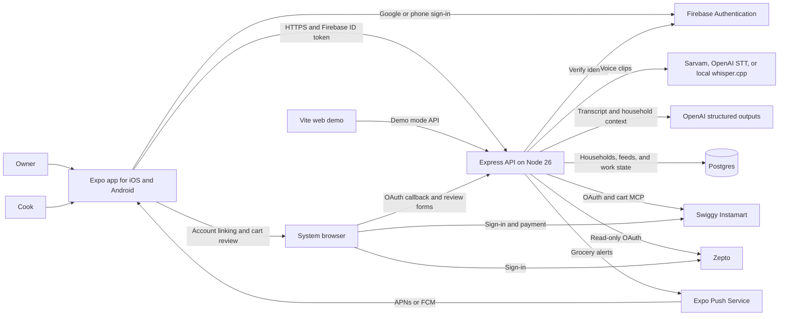
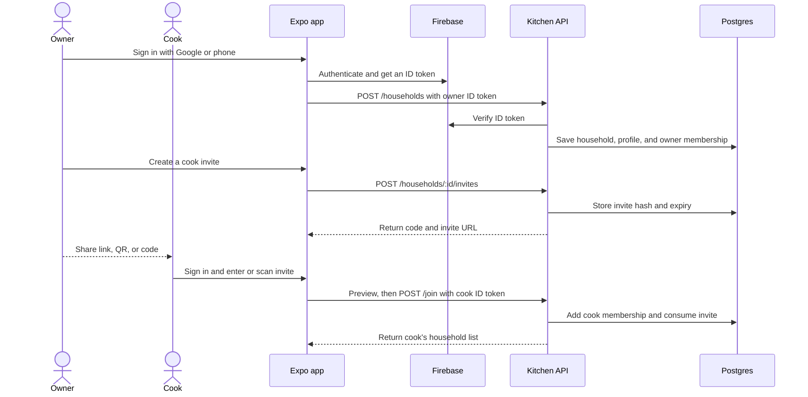
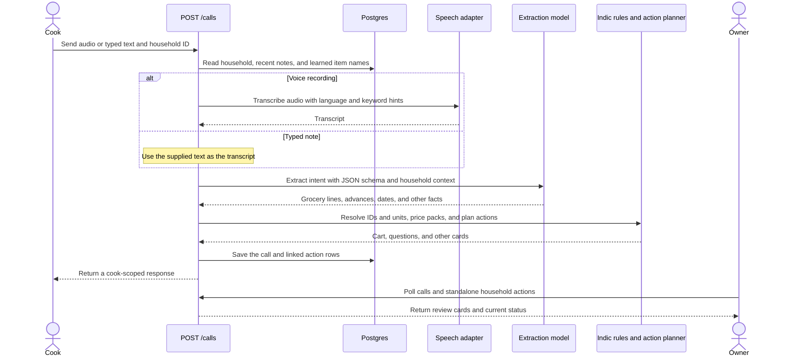
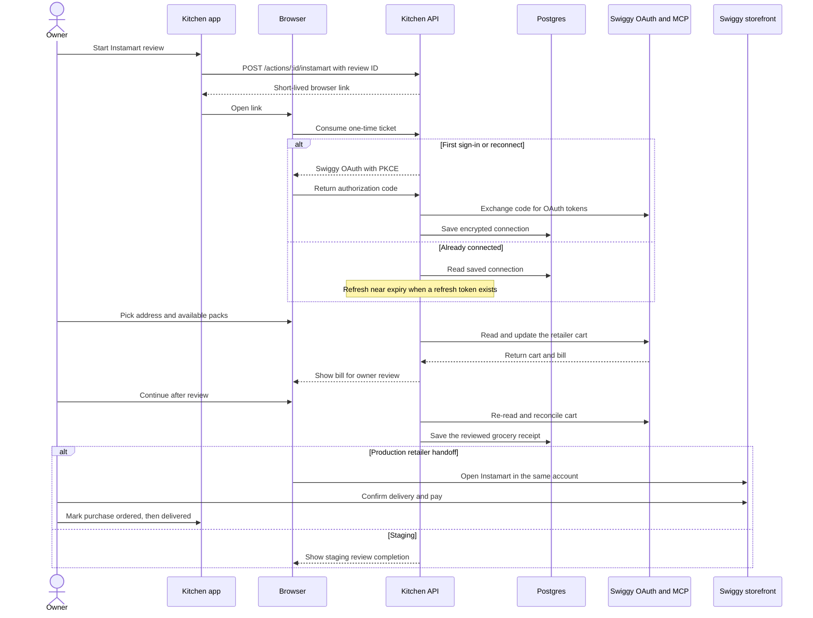
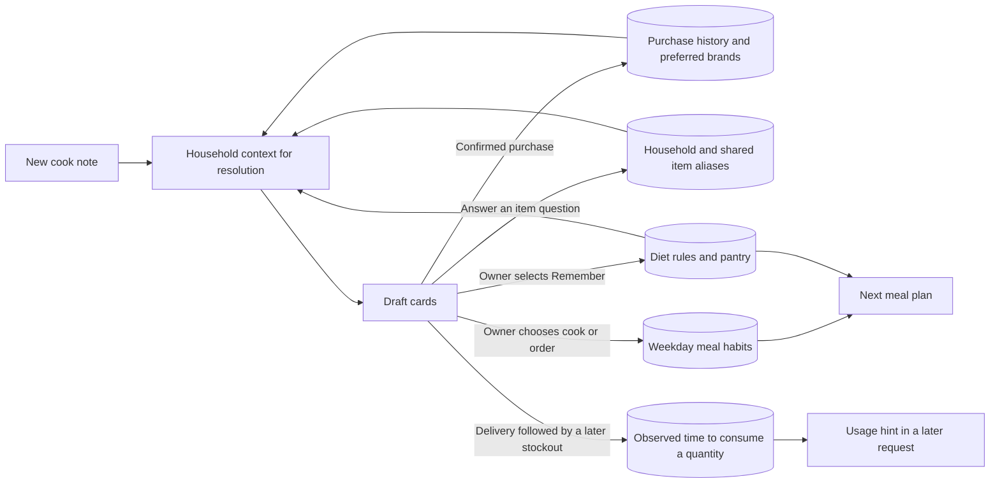

# Kitchen app architecture

Kitchen turns a cook’s voice note or text into grocery requests, clarification questions, cash advances, and meal plans. The owner reviews changes and confirms purchases. The API keeps the household’s preferences and purchase history so the next request can use what the household already knows.

- [System overview](#system-overview)
- [Sign-in and household access](#sign-in-and-household-access)
- [From a note to action cards](#from-a-note-to-action-cards)
- [Grocery review, payment, and delivery](#grocery-review-payment-and-delivery)
- [Meal plans, advances, and alerts](#meal-plans-advances-and-alerts)
- [Postgres and household memory](#postgres-and-household-memory)
- [Running and verifying the system](#running-and-verifying-the-system)

## System overview

The Expo app contains owner and cook screens in one binary. It uses React Native Firebase for identity, Expo Audio for recording, deep links or QR codes for joining, and the system browser for retailer authorization. Expo Go supports the isolated demo. Firebase sign-in and remote notifications use a native build. The Vite web app is a separate fixture-based demo. It can compare the plain pipeline with the household-aware pipeline. Express serves the built web app in demo mode. [Mobile entry point](../mobile/App.tsx) · [Native build and authentication](../mobile/AUTH.md) · [Web demo](../web/src/App.tsx) · [Express setup](../src/app.ts)

| Component | Responsibility | Source |
| --- | --- | --- |
| Server | Configures identity, provider adapters, Postgres, and the scheduler | [`src/server.ts`](../src/server.ts) |
| HTTP API | Authenticates and scopes requests, processes notes, persists cards, and handles owner actions | [`src/app.ts`](../src/app.ts) · [`auth.ts`](../src/actions/auth.ts) |
| Pipeline | Transcribes audio, asks the LLM for structured data, and plans actions | [`process.ts`](../src/pipeline/process.ts) · [`meals.ts`](../src/pipeline/meals.ts) |
| Indic normalization | Resolves Hindi, Hinglish, and Telugu item names, brand aliases, quantities, and units | [`src/indic/`](../src/indic/) |
| Actions | Prices household packs, builds clarification cards, handles retailer sessions, and runs due work | [`src/actions/`](../src/actions/) |
| Contracts | Defines the shared input, transcript, extraction, household, cart, action, and timing types. The frozen item fixture is the vocabulary used across the lexicon, extraction, and catalog. | [`contracts.ts`](../src/contracts.ts) · [`items.json`](../fixtures/items.json) |
| Evaluation | Runs the same pipeline against labeled speech, scores extraction, and reports latency | [`eval/run.ts`](../eval/run.ts) |

## Sign-in and household access

Firebase establishes identity. Postgres establishes each user’s role inside a household. The mobile API client sends the ID token as a bearer token over HTTPS. The API verifies token revocation and resolves the caller’s membership against the requested household, call, or card. A cook can join multiple households. Each household has one owner and one active cook. Invites expire after 24 hours, can be used once, and can be canceled by the owner. Revoking cook access removes that household membership. [Mobile API client](../mobile/api.ts) · [Authorization middleware](../src/actions/auth.ts) · [Membership and invite store](../src/actions/auth-store.ts)

The owner feed shows full review cards. The cook feed exposes grocery questions, shared meal choices, and confirmed grocery tracking. Its receipt view omits prices, fees, and delivery address. The response to the cook’s own submission also includes its transcript and timings. Demo mode uses a seeded household and legacy role selection. Run it against an isolated database with synthetic data. [Feed projection](../src/app.ts#L109) · [Mobile role selection](../mobile/App.tsx) · [Server auth configuration](../src/actions/AUTH.md)

## From a note to action cards

1. The API accepts a raw `audio/*` upload or JSON with a `transcript`. It writes audio to a temporary file and removes that file after processing. Sarvam is the default speech adapter. OpenAI STT and local whisper.cpp are selectable. The pipeline falls back to OpenAI when transcription hits the recognized Sarvam recording-length error. [Audio upload and call route](../src/app.ts#L185) · [Temporary audio](../src/app.ts#L53) · [Provider selection](../src/server.ts) · [Transcription and timings](../src/pipeline/process.ts#L271)
2. The extraction prompt includes preferred brands, pantry, diet rules, up to 20 recent purchases, and up to five previous notes. Structured output captures item words, quantities, uncertainty, deadlines, advances, and dates when the cook will be off. The Indic rules reconcile that output against canonical item IDs and spoken units. A missing quantity can use a previous purchase or one catalog pack. A quantity the transcript could not resolve is flagged for clarification. [Extraction and normalization](../src/pipeline/process.ts#L110) · [Quantity normalization](../src/indic/quantity.ts)
3. For a note such as *“aadha kilo pyaaz”*, the result can be an `onion` request for 0.5 kg. The local catalog prices sellable packs and preserves the original request for review. Unsafe quantities and uncertain items produce questions. An answer can add a line and rebuild the pending cart. If it resolves an ambiguous item word, the household can reuse that answer next time. [Pricing and pack rules](../src/actions/cart.ts) · [Action planner](../src/actions/plan.ts) · [Answer route](../src/app.ts#L400)
4. Postgres stores the transcript, extraction, and action rows. The feed assembles each call with the latest state of its cards. Standalone cards, such as a manually requested meal plan, come from the household actions endpoint. Expo polls both feeds. The owner feed polls every three seconds and the cook feed every four seconds. [Store reads and writes](../src/actions/store.ts#L265) · [Mobile feed polling](../mobile/App.tsx)

## Grocery review, payment, and delivery

The owner can edit quantities or remove a line. Each review has a revision ID. An edit or confirmation using an older revision is rejected so the owner can see the current bill first. The approval limit flags a cart total for review. Buying and marking a purchase still require the owner’s action. [Review and tracking routes](../src/app.ts#L275) · [Owner cart UI](../mobile/CartReview.tsx)

| Purchase path | What Kitchen does |
| --- | --- |
| Manual purchase | Opens individual store search links. The owner edits the household cart to match what was bought and records the purchase and delivery. |
| Instamart | Lets the owner connect Swiggy separately under **Grocery accounts**, or during their first cart review. The browser flow reads address and pack choices, preserves existing retailer items, and reconciles the updated retailer basket. Production hands off to the Swiggy storefront for payment. Staging ends after bill review. Kitchen doesn’t call retailer checkout or receive a UPI payment link for the grocery order. |
| Immediate or scheduled order cards | An owner confirmation creates or approves an order card. The server uses a simulated Swiggy client for this path. The worker runs every minute to claim and place confirmed orders that are due. |
| Zepto and Blinkit | Zepto can save an OAuth connection with read-only scope once configured. Blinkit opens the storefront. Kitchen has no cart or payment handoff for either provider. |

Instamart stores the intended basket before updating it. After an ambiguous provider timeout, reopening the request reconciles the actual retailer basket against that intent. Recording a purchase requires the receipt for the current revision. The household history records the packs added for the request, while the retailer bill can also include previously present items. The owner marks delivery in Kitchen. [Retailer browser flow](../src/actions/instamart.ts) · [Cart reconciliation](../src/actions/instamart-intent.ts) · [Purchase tracking](../src/app.ts#L301) · [Scheduler configuration](../src/server.ts#L41)

The API seals retailer access tokens, optional refresh tokens, and expiry data with AES-256-GCM, using a key derived for each household and provider from the server’s credential key. Postgres also holds short-lived OAuth tickets and browser sessions. Provider sign-in handles phone and OTP entry. Disconnect clears the saved credential and invalidates Kitchen’s review sessions for that connection. [OAuth and credential lifecycle](../src/actions/instamart.ts#L32) · [Connection storage](../src/actions/store.ts#L179)

## Meal plans, advances, and alerts

- **Meal plans.** The owner can tap **Plan tomorrow** or a cook’s note can provide a date when they’ll be off. The API defaults the manual request to tomorrow in India. The model generates cook and delivery menus based on household diet and fitness goals. A weekday habit takes precedence when it has a clear preference. The cook’s off day breaks a tie or supplies the default. The cook option creates a grocery cart after the owner selects it. Ingredients already present in the pantry are omitted. The delivery option supplies dish search links. The selected dishes appear in the cook feed. [Meal planner](../src/pipeline/meals.ts) · [Plan selection](../src/app.ts#L430)
- **Cash advances.** An extracted advance becomes an owner-only approval card. The API builds a `upi://pay` link from the cook’s saved UPI ID and the requested amount. After approval, the owner can open their UPI app to pay. Kitchen tracks card approval. Payment completion happens outside Kitchen. [Advance planning](../src/actions/plan.ts) · [Advance approval](../src/app.ts#L342)
- **Grocery alerts.** An owner registers an Expo push token. A cook-originated cart with items can queue a ready alert, and the owner can set a future reminder on an open cart. The worker leases due alerts in Postgres, sends through Expo, and backs off on transient failures. Completing the purchase stops pending reminders. Notification data identifies the household and card so Expo can open the right request. [Alert queue and worker](../src/actions/alerts.ts) · [Mobile alert handling](../mobile/OwnerAlerts.tsx)

## Postgres and household memory

| Persisted data | Tables | What reads it back |
| --- | --- | --- |
| Household setup and preferences | `households`, `household_profiles` | Feed routing, extraction context, catalog pricing, and meal planning |
| Identity and invitations | `household_members`, `cook_invites`, `cook_invite_attempts`, legacy `owner_keys` | Membership middleware, join flow, and legacy household recovery |
| Notes, cards, receipts, and order claims | `calls`, `actions` | Owner and cook feeds, cart review, and scheduler |
| Clarified words and stockout observations | `word_votes`, `usage_samples` | Item resolution and grocery usage hints |
| Retailer credentials, OAuth state, and intended cart | `instamart_links`, `instamart_state`, `instamart_prepared` | Account linking, browser handoff, and cart reconciliation. The first two also serve Zepto. |
| Notification subscriptions and queued alerts | `owner_devices`, `cart_alerts` | Expo registration and alert delivery worker |

A household’s own item answer takes priority. Shared word mappings require agreement from at least three households using the same cook language and at least 90% of votes for the word. When a later note reports a stockout, the store can pair it with the last delivered receipt for that item and record how many days that bought quantity lasted. Confirmed purchases update history and catalog-supported brand preferences. A **Remember** card requires the owner’s choice before the fact enters the household’s diet rules. [Household schema, word votes, and usage samples](../src/actions/store.ts) · [Remember and meal choices](../src/app.ts#L400)

The store creates tables and applies additive schema changes on startup under a Postgres advisory lock. The API stores household and card payloads as JSON text and uses SQL indexes and typed columns for lookups and coordination. Cart edits and purchase confirmation use row locks and revision checks. Order workers claim each confirmed order before provider I/O. An interrupted checkout becomes failed after its claim expires because the provider might already have received it. [Store and transaction boundaries](../src/actions/store.ts) · [Postgres design notes](db-migration.md) · [Order worker](../src/actions/orders.ts)

## Running and verifying the system

| Surface | Configuration and entry point |
| --- | --- |
| API | `pnpm dev` runs native TypeScript on Node 26. The server requires `DATABASE_URL` and `AUTH_MODE`. Sarvam STT uses `SARVAM_API_KEY` by default, and structured extraction uses `OPENAI_API_KEY`. `GET /health` reports the selected STT and LLM. [Environment sample](../.env.example) · [Server](../src/server.ts) |
| Expo | `pnpm --dir mobile start` starts the dev server. Set `EXPO_PUBLIC_API_URL` for a device that cannot use the local default. The signed-in app requires an HTTPS API, matching Firebase native configuration, and a native build. [Mobile configuration](../mobile/AUTH.md) |
| Retailers | Instamart requires a configured public origin and approved callback. Zepto uses an approved public OAuth client and `ZEPTO_CLIENT_ID`. Both use the stable server-side `INSTAMART_CREDENTIAL_KEY` for encryption. [Server auth and retailer configuration](../src/actions/AUTH.md) · [Instamart integration notes](instamart.md) |
| Deployment | The supplied Lightsail setup uses Caddy for TLS and systemd to run Express. The API can use a pooled Neon Postgres connection. In demo mode, Express can also serve the Vite build. [Deployment guide](../deploy/README.md) · [Caddy config](../deploy/Caddyfile) |
| Automated checks | `pnpm check` typechecks and runs tests. Use `TEST_DATABASE_URL` in `.env.test` for disposable schemas. GitHub Actions uses Postgres 17. Provider smoke tests are opt-in and the Instamart live test reads saved addresses. [Package scripts](../package.json) · [CI](../.github/workflows/ci.yml) · [Instamart smoke test](../src/actions/instamart.live.test.ts) |
| Evaluation | `eval/run.ts` compares plain extraction, the household-aware pipeline, and speech providers. An oracle run uses human transcripts to isolate extraction from STT errors. The reports capture item and quantity/unit scores, word error rate, and p50/p95/p99 timings for STT, extraction, planning, and total latency. [Runner](../eval/run.ts) · [Scoring](../eval/score.ts) · [Recorded results](../eval/RESULTS.md) |

Live retailer availability depends on provider access, callback approval, and environment configuration. The code paths above describe the implemented integration. Use the provider smoke test or a configured staging account to verify access for a specific environment.
